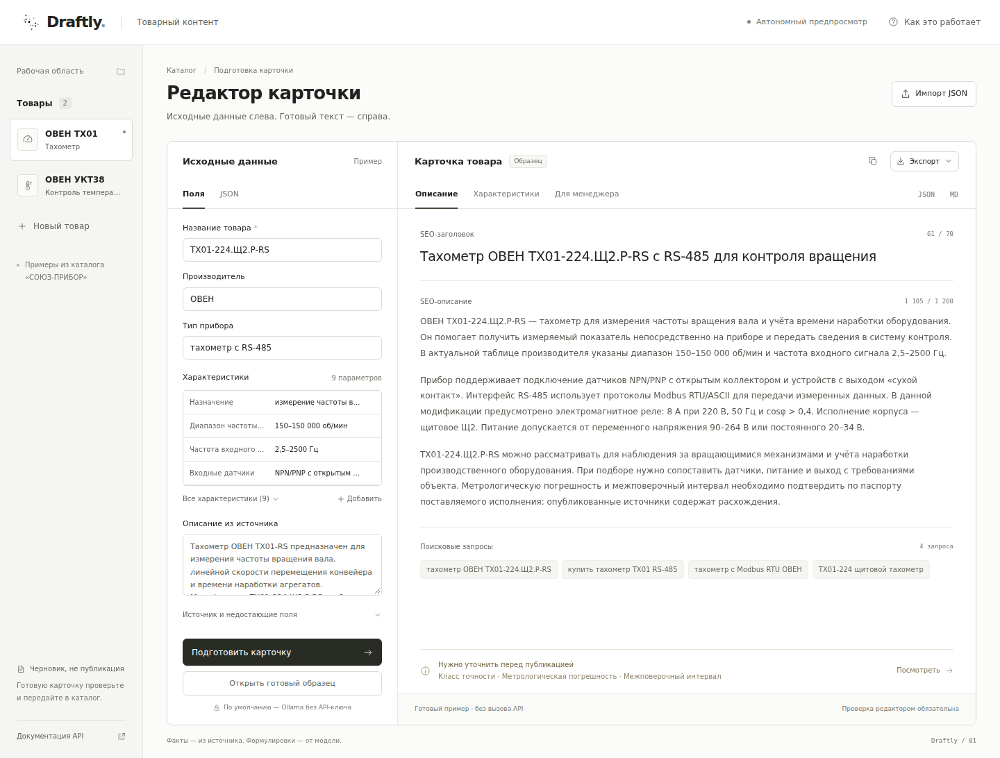

# AI-помощник для карточек товаров

Прототип на Python/FastAPI для тестового задания «СОЮЗ-ПРИБОР».
Принимает данные прибора через веб-форму или JSON и готовит черновик:
SEO-заголовок до 70 символов, описание на 800–1200 символов, характеристики,
3–5 поисковых запросов и блок для менеджера. Результат можно скопировать
или скачать в JSON и Markdown.



*Интерфейс с демонстрационной карточкой.*

## Запуск

Нужны Python 3.10+ и работающая Ollama. На машине с моделью загрузите её:

```bash
ollama pull qwen3.5:9b
```

Установите и запустите приложение:

```bash
git clone https://github.com/nikolasVO/catalog-card-ai.git
cd catalog-card-ai
python3 -m venv .venv
source .venv/bin/activate
pip install -r requirements.txt
cp .env.example .env
uvicorn app.main:app --host 127.0.0.1 --port 8000
```

Интерфейс: http://127.0.0.1:8000. Документация API: http://127.0.0.1:8000/docs.

По умолчанию приложение обращается к Ollama на `127.0.0.1:11434`, ключ не нужен.
Модель может работать на отдельном сервере: укажите доступный адрес в
`OLLAMA_BASE_URL` файла `.env`. Параметры модели и облачного API приведены
в [.env.example](.env.example); `.env` исключён из Git.

Для просмотра интерфейса без установки откройте [preview.html](preview.html).
В нём доступны готовые образцы, генерация требует запущенного сервиса.

## Примеры

Входные данные: [examples/products.json](examples/products.json).
В исходном YML не было подробных характеристик, поэтому они подготовлены
по документации. [Источники и расхождения](docs/SOURCES.md) описаны отдельно.

Результаты настоящего запуска Ollama с Qwen3.5 9B:

- [Тахометр ТХ01-224.Щ2.Р-RS](examples/outputs/live/tachometer.md).
- [Измеритель температуры УКТ38-Щ4.ТПП](examples/outputs/live/temperature-monitor.md).

Рядом сохранены JSON и манифест с контрольными суммами. Файлы непосредственно
в `examples/outputs/` — ручные демонстрационные образцы.

## Как устроено

Техническая таблица переносится из входного JSON. LLM получает факты и
[промпт](app/prompts.py), возвращает текст по JSON-схеме. Приложение проверяет
длины, числовые значения, единицы и отдельные технические утверждения.
Если ответ нарушает требования, выполняется одна попытка исправления.

Отсутствующие параметры отмечаются как «данных нет». При недостатке фактов
сервис возвращает `needs_data`. Ошибки входного JSON и API обрабатываются
отдельно.

Эти проверки не гарантируют достоверность свободного текста: перед публикацией
нужен редактор. Автоматического импорта YML нет. Дальнейшие улучшения —
импорт характеристик из документации и привязка каждого параметра к источнику.
[Решения и ограничения](docs/DECISIONS.md) описаны подробнее.

## Проверка

```bash
pip install -r requirements-dev.txt
python -m pytest -q
python scripts/verify_examples.py --output-dir examples/outputs/live --require-manifest
```

Тесты используют подменные ответы API. Сохранённые результаты реальной
генерации проверяются отдельно. [Отчёт о проверках](docs/VERIFICATION.md).
